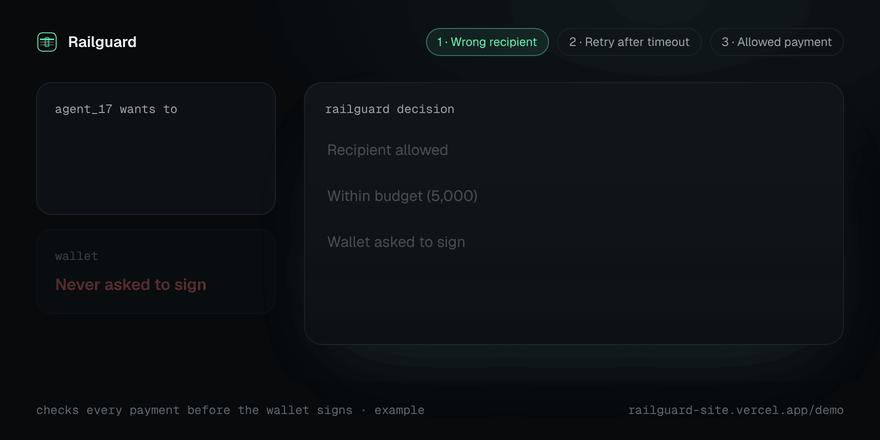
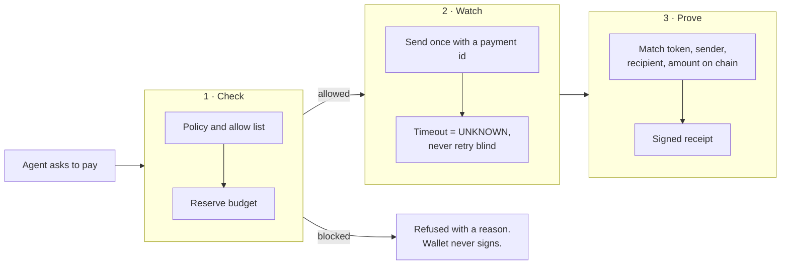

<div align="center">

<a href="https://railguard-site.vercel.app">
  <picture>
    <source media="(prefers-color-scheme: dark)" srcset="docs/assets/readme/wordmark-dark.svg">
    <source media="(prefers-color-scheme: light)" srcset="docs/assets/readme/wordmark-light.svg">
    
  </picture>
</a>

### AI agents can spend money. Railguard makes sure they spend it right.

Open-source guardrails between an AI agent and the wallet or payment API it controls.

[**Site**](https://railguard-site.vercel.app) · [**Demo**](https://railguard-site.vercel.app/demo) · [**Proof**](https://railguard-site.vercel.app/proof) · [**Docs**](docs/README.md) · [**Video**](https://youtu.be/L-Gss08bzR0)

[](https://github.com/prasanthkuna/railguard-gateway/actions/workflows/pr-checks.yml)
[](https://github.com/prasanthkuna/railguard-gateway/actions/workflows/testnet-evidence.yml)
[](#proofs)
[](LICENSE)
[](https://github.com/prasanthkuna/railguard-gateway/commits/main)

<br>

<a href="https://railguard-site.vercel.app/demo">
  
</a>

</div>

<a id="start-here"></a>

## Why Railguard

An agent with a wallet will eventually retry a payment that already went through, overspend a shared
budget, or send money to the wrong address. Railguard sits in front of the wallet and does three things
on every payment: **check** it before signing, **watch** it after sending, and **prove** the result
from chain facts.

> **Status:** `v0.1.0-alpha`. Testnet reference implementation. Not ready for mainnet funds.

## What it stops

- **Paying twice.** Every payment gets one id before it leaves. After a timeout the state is `UNKNOWN`,
  not failed, so Railguard checks the chain before anything is sent again.
- **Going over budget.** Money is reserved before it is sent. Two agents sharing 100 USDC cannot both
  spend 80.
- **Wrong recipient.** Approval is bound to recipient, asset, amount and network. If any field changes,
  Railguard blocks it before the wallet is asked to sign.

<a id="lifecycle"></a>

## How it works



A signature or a broadcast is not proof. A payment is only final after Railguard matches it against
the chain (or the payment provider) and writes a receipt. More detail:
[ARCHITECTURE.md](docs/ARCHITECTURE.md) and [STATE_MACHINE.md](docs/STATE_MACHINE.md).

<a id="quick-start"></a>

## Quickstart

Needs [Bun](https://bun.sh) 1.3 or newer.

```bash
git clone https://github.com/prasanthkuna/railguard-gateway.git
cd railguard-gateway
bun install

bun run test                                   # full unit suite, no keys needed
bun test packages/kernel/src/adapters/airwallex # lost response -> retry blocked -> exactly one transfer
bun run testnet-evidence                       # verify a live Base Sepolia USDC transfer from chain facts
bun run dev:site                               # this site on http://localhost:3001
```

Running the full API locally needs the [Encore CLI](https://encore.dev/docs/install): `encore run`
(see [INTEGRATION.md](docs/INTEGRATION.md)).

<a id="verified-rails"></a>

## Proofs

Every row is built from a file in [`evidence/`](evidence) by
[`scripts/readme-proofs.ts`](scripts/readme-proofs.ts). Click through to check it yourself on the explorer.

<!-- PROOFS:START -->
<!-- Generated by scripts/readme-proofs.ts from evidence/. Do not edit by hand. -->

| Chain / rail | What was proven | Status | Tx / explorer | Date |
| --- | --- | --- | --- | --- |
| [Arbitrum Sepolia](https://railguard-site.vercel.app/proof/arbitrum-sepolia) | 0.01 USDC external-wallet transfer matched on chain (token, sender, recipient, amount) | ✅ Settlement verified | [`0x243ec1…608d`](https://sepolia.arbiscan.io/tx/0x243ec1e8eb6a992a85a035af11edd5ff70d78e3b84e7eb6c78ab5badc409608d) | 30 Sep 2026 |
| [Arbitrum Sepolia](https://github.com/prasanthkuna/railguard-gateway/tree/main/evidence/arbitrum-sepolia-hook) | 3 Railguard hook contracts deployed, source verified on Arbiscan and Sourcify | ✅ Source verified | [`0x756829…965E`](https://sepolia.arbiscan.io/address/0x756829c3ab0eB02b22fe4D7C9E35252A9738965E#code) | 23 Oct 2026 |
| [Stellar Soroban](https://railguard-site.vercel.app/proof/stellar-testnet) | Policy contract paid 1.25 USDC once and rejected 5 bad calls (replay, wrong recipient, overspend) | ✅ CONFIRMED | [`2e8c13fa…8353`](https://stellar.expert/explorer/testnet/tx/2e8c13fab4feb88a451ec617dc9c5a129a600e7e6dc62c1868d67336702f8353) | 23 Oct 2026 |
| [Stellar testnet](https://railguard-site.vercel.app/proof/stellar-testnet) | 1 XLM payment confirmed from Horizon facts | ✅ CONFIRMED | [`3dc32258…e437`](https://stellar.expert/explorer/testnet/tx/3dc3225844f711f9f96ead65690d224b7ccfd616d1da5387df6bfc63bfb8e437) | 4 Oct 2026 |
| [Monad testnet](https://railguard-site.vercel.app/proof/monad-testnet) | 1 USDC transfer matched from receipt logs | ✅ CONFIRMED | [`0x1cbd46…aab2`](https://testnet.monadvision.com/tx/0x1cbd46100de39c60d88d8d7ee7a1dc66cf2c9c16956ebb403b69c1751b98aab2) | 4 Oct 2026 |
| [Metal testnet](https://railguard-site.vercel.app/proof/metal-testnet) | 3 agents under on-chain limits: over-cap buy refused, duplicate payout blocked | ✅ CONFIRMED | [`0x9139ec…b875`](https://testnet.metalntwx.com/tx/0x9139ec9ee4ca8462e6aa5898171ec14ec3376a24d5fd9a0c707846835b4bb875) | 23 Oct 2026 |
| [Airwallex sandbox](https://prebroadcast.vercel.app/incidents) | Create response lost, 1 retry blocked, exactly 1 transfer (fake money) | ✅ CONFIRMED | [`chaos-live.json`](https://github.com/prasanthkuna/railguard-gateway/blob/main/evidence/airwallex-sandbox/chaos-live.json) | 22 Oct 2026 |
| Base Sepolia | Verifier matches a live USDC transfer, re-run by CI on every push | [](https://github.com/prasanthkuna/railguard-gateway/actions/workflows/testnet-evidence.yml) | latest run | live |

<sub>7 of 7 committed proofs verified from files in [`evidence/`](evidence). Regenerated by [readme-proofs](.github/workflows/readme-proofs.yml).</sub>
<!-- PROOFS:END -->

Public proof pages: [railguard-site.vercel.app/proof](https://railguard-site.vercel.app/proof). They
separate what Railguard executed from what it independently verified.

## Use it

**SDK**

```ts
import { RailguardClient, check, createClientFromEnv } from "@railguard/sdk"

const client = new RailguardClient(createClientFromEnv())
const result = await check(client, intent) // "ALLOW" or "DENY", with a reason and budget reservation
if (result.decision === "DENY") throw new Error("Blocked by Railguard")
```

**CLI** `bun run railguard --help` (`scan`, `protect`, `status`, `receipts`).
**MCP** `bun run railguard:mcp` for Cursor, Claude and other agent tools.
Setup for all three: [INTEGRATION.md](docs/INTEGRATION.md).

## Repo layout

```text
apps/api         Gateway API (Encore): authorize, reserve, execute, reconcile, receipts
apps/site        Public site and proof pages (Next.js)
apps/operator    Signed-in operator console
packages/        kernel, policy, settlement, reconciliation, sdk, cli, mcp, adapters
contracts/       EVM hook contracts and the Soroban policy contract
evidence/        Committed proof files behind the table above
labs/            Live labs (Metal Kit 11, failure suite)
docs/            Architecture, integration guides, judge paths
```

## Docs

| | |
| --- | --- |
| [Architecture](docs/ARCHITECTURE.md) | Runtime and payment lifecycle |
| [State machine](docs/STATE_MACHINE.md) · [Invariants](docs/INVARIANTS.md) | The rules that keep money safe |
| [Integration](docs/INTEGRATION.md) | SDK, CLI, MCP and rails |
| [Components](docs/COMPONENTS.md) | What lives where |
| [Judge paths](docs/JUDGE_PATHS.md) | Step-by-step reviewer walkthroughs |
| [ecosystems.yaml](docs/ecosystems.yaml) | Machine-readable list of supported rails |

## Hackathon entries

Short pointers. Full walkthroughs are in [docs/JUDGE_PATHS.md](docs/JUDGE_PATHS.md).

### Monad Metropolis entry

Tag [`metropolis-submission`](https://github.com/prasanthkuna/railguard-gateway/tree/metropolis-submission)
(`29ef757`). Later work (Airwallex, Arc) came after the deadline.

### Airwallex Agentic Banking Hackathon (Track 3): 5-minute judge path

A Gemini payment-ops agent pays suppliers on Airwallex. A create call times out after the transfer was
made; Railguard blocks the retries and confirms exactly one transfer. Try it at
[prebroadcast.vercel.app/incidents](https://prebroadcast.vercel.app/incidents).
[Full path](docs/JUDGE_PATHS.md#airwallex-agentic-banking-hackathon-track-3-5-minute-judge-path) ·
[build notes](docs/grants/AIRWALLEX_BUILD.md).

### Airwallex Kit 11 (x402 Business Agents) + Metal Award: 5-minute judge path

Three agents share one Metal testnet account under on-chain limits. An over-cap purchase is refused, a
person approves new limits, and a lost payout is paid once. Try it at
[prebroadcast.vercel.app/x402-agents](https://prebroadcast.vercel.app/x402-agents).
[Full path](docs/JUDGE_PATHS.md#airwallex-kit-11-x402-business-agents--metal-award-5-minute-judge-path) ·
[rerun guide](docs/grants/AIRWALLEX_KIT11_METAL.md).

## Related repositories

- [railguard-protocol](https://github.com/prasanthkuna/railguard-protocol): core, SignGate and contracts
- [agent-payment-failure-lab](https://github.com/prasanthkuna/agent-payment-failure-lab): Failure Lab and Failure Atlas
- [x402-guard](https://github.com/prasanthkuna/x402-guard): x402 policy adapter

## Contributing

Issues and pull requests are welcome. Read [CONTRIBUTING.md](CONTRIBUTING.md), then run
`bun run lint && bun run test` before opening a PR.

## Security

Please report vulnerabilities privately to **prasanthkuna@gmail.com**, not in public issues. See
[SECURITY.md](SECURITY.md).

## License

[Apache-2.0](LICENSE). Copyright 2026 Prasanth Kuna.

---

<div align="center">

Built by **Prasanth Kuna** ·
[About](https://railguard-site.vercel.app/about) ·
[LinkedIn](https://www.linkedin.com/in/prasanth-kuna-1463631b3) ·
[X](https://x.com/prasanth_kuna)

</div>
